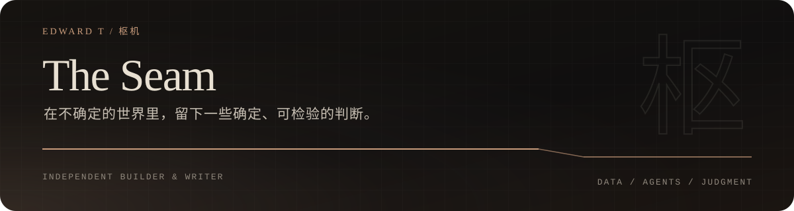

  

  I look for the seam where data has already turned and consensus has not.
  I write the judgment, then build agent systems that can carry it into real workflows.

  <a href="https://edward4226.github.io/">Website</a>
  &nbsp;·&nbsp;
  <a href="https://edward4226.github.io/zh/">中文</a>
  &nbsp;·&nbsp;
  <a href="https://edward4226.github.io/blog/">Writing</a>
  &nbsp;·&nbsp;
  <a href="https://edward4226.github.io/rss.xml">RSS</a>

---

## 现在 / Now

**Building** — A new agent system for turning long-running work into inspectable, accountable tasks. Public details will appear through [The Seam](https://edward4226.github.io/).

**Writing** — Essays on data, AI, and the institutional seams where consensus is repricing.

**Working rule** — State the judgment. Show the evidence. Name the limit.

Last reviewed · 2026.10.23

## 精选 / Selected

<table>
<tr>
<td width="58%" valign="top">
  01 · PUBLICATION
  <h3><a href="https://edward4226.github.io/">枢机 / The Seam</a></h3>
  
Data-driven essays on the places where the data has already turned and consensus has not.

  
<a href="https://edward4226.github.io/blog/">Read the archive →</a>

</td>
<td width="42%" valign="top">
  02 · PRIVATE BUILD
  <h3>Next agent system</h3>
  
Turning long-running agent work into inspectable, accountable tasks.

  
<code>IN DEVELOPMENT</code>

</td>
</tr>
</table>

## 最近写作 / Latest writing

<!-- LATEST-WRITING:START -->
- [You bought a futures contract that settles in four years](https://edward4226.github.io/blog/diploma-futures/) · `2026-06-11`
<!-- LATEST-WRITING:END -->

## 我怎么工作 / How I work

- **Evidence over eloquence.** A point of view is useful only when the proof and the uncertainty are both visible.
- **Permissions over autonomy.** Agent systems should show what they can touch, where they stop, and who takes over.
- **Recovery over demos.** A system becomes trustworthy when failure is legible and reversible.

## 工具 / Toolbox

`Agent systems` · `TypeScript` · `Python` · `Astro` · `Codex` · `Claude Code`

## 别处 / Elsewhere

The public archive lives at **[edward4226.github.io](https://edward4226.github.io/)**. 
For new essays, subscribe to the **[RSS feed](https://edward4226.github.io/rss.xml)**.
